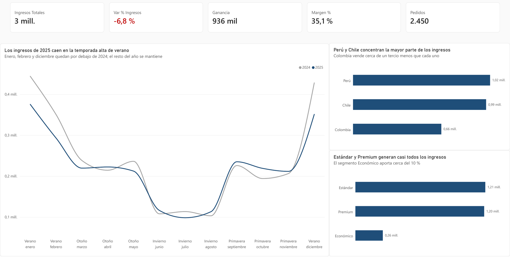
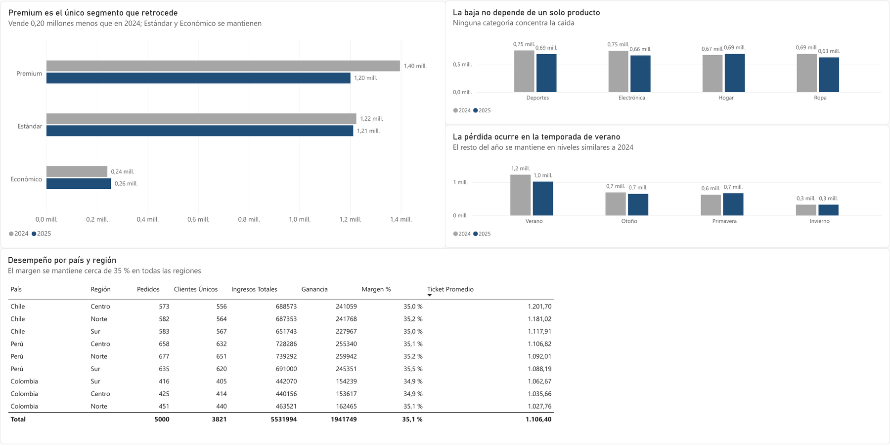

# Dashboard de desempeño comercial: Andes Retail Group

Dashboard en Power BI que explica por qué cayeron los ingresos de una cadena de retail con operación en Perú, Chile y Colombia entre 2024 y 2025, con una narrativa SCQA (Situación, Complicación, Pregunta y Respuesta) para la dirección.

**Resultado principal:** los ingresos cayeron 6,8 % (de 2,86 a 2,67 millones) con el margen estable en 35,1 %. No es un problema de costos sino de ventas, y se concentra en el segmento Premium durante el verano.

[Documentación completa del proyecto](documentacion.md) · [Descargar el dashboard (.pbix)](dashboard_andes_retail.pbix)

## Contexto y objetivo

La dirección de Andes Retail vio caer los ingresos de 2025 y necesitaba entender la causa antes de ajustar su plan comercial. El objetivo es un dashboard de dos vistas: una que muestre qué pasó y otra que explique por qué, con una narrativa que lleve de los datos a la decisión.

## Preguntas de negocio

1. **Vista Overview:** ¿cómo evolucionó el ingreso total entre 2024 y 2025?
2. **Vista Detalle:** ¿por qué cayeron los ingresos?

## Dashboard



*Vista Overview. Los ingresos caen 6,8 % con el margen estable en 35,1 %; la diferencia frente a 2024 se concentra en los meses de verano.*



*Vista Detalle. Premium es el único segmento que retrocede, la caída no depende de una categoría y ocurre en verano; el margen se mantiene cerca de 35 % en todas las regiones.*

## KPIs

| KPI | Definición |
|---|---|
| Ingresos | Suma de `Ingresos` |
| Ganancia | Ingresos menos costo |
| Margen % | Ganancia sobre ingresos |
| Pedidos | Conteo de pedidos |
| Clientes únicos | Conteo distinto de `ID_Cliente` |
| Ticket promedio | Ingresos entre pedidos |
| Var % Ingresos | Ingresos frente al año anterior |

## Hallazgos

| Vista | Hallazgo |
|---|---|
| Overview | Los ingresos bajaron 6,8 % y la ganancia pasó de 1,01 millones a 936 mil, con el margen estable en 35,1 %. Se registraron 100 pedidos menos (de 2.550 a 2.450). La caída se concentra en enero, febrero y diciembre, los meses de verano y de mayor venta. |
| Detalle | Premium es el único segmento que retrocede: pasa de 1,40 a 1,20 millones (−14 %), con 0,17 millones menos en verano, 71 pedidos menos en el año y un ticket promedio 5,6 % más bajo. Baja en las cuatro categorías y el margen se mantiene en todas las regiones, lo que descarta un problema de producto o de rentabilidad. Perú concentra la mayor parte de la caída (de 1,14 a 1,02 millones). |

### Recomendaciones

1. Lanzar una campaña dirigida a clientes Premium antes y durante el verano (diciembre a febrero).
2. Crear un programa de fidelización: casi ningún cliente repite compra (3.821 clientes en 5.000 pedidos).
3. Priorizar Perú, donde se concentra la mayor parte de la caída.

### Limitaciones

- El dataset no tiene precios de la competencia, inversión en marketing ni inventario, así que el dashboard ubica la caída (Premium, verano, Perú) pero no prueba su causa.
- Cubre dos años: no permite saber si 2024 fue un año atípicamente alto.
- La estación viene definida en los datos; en Colombia no hay estaciones, por lo que esa lectura aplica sobre todo a Perú y Chile.

## Cómo se construyó

- **Datos:** `Andes_Retail_Group_2024_2025.xlsx`, 5.000 pedidos y 12 columnas (fecha, estación, país, región, segmento, categoría, unidades, precio, ingresos y costo).
- **Power Query:** corrección de tipos de datos, fecha con configuración regional en español, columna condicional `Nivel_Venta` (≥ 1.000 → Venta Alta) y columnas de año y mes. Validación con el perfil de columnas: 100 % de valores válidos.
- **Medidas DAX:** Ingresos, Costo, Ganancia, Margen %, Pedidos, Clientes Únicos, Ticket Promedio, Ingresos Año Anterior y Var % Ingresos.
- **Diseño:** dos vistas con la misma regla de color (azul para 2025, gris para 2024, rojo y verde solo para la variación) y títulos que comunican el hallazgo.

El detalle de cada paso, la planificación de las vistas, la narrativa SCQA y el mensaje para el equipo están en la [documentación](documentacion.md).

## Estructura del repositorio

```
dashboard_andes_retail/
├── dashboard_andes_retail.pbix   Dashboard en Power BI
├── documentacion.md              Proceso completo y narrativa SCQA
├── img/                          Capturas del dashboard
└── README.md
```

Para explorar el dashboard, descarga el archivo `.pbix` y ábrelo con Power BI Desktop. Los datos son un caso de estudio ficticio del bootcamp de Análisis de Datos de TripleTen: no corresponden a una empresa real.

## Herramientas

Power BI Desktop · Power Query · DAX

## Autor

**Felipe Vásquez Torres**, analista de datos con experiencia en supply chain y operaciones.

[LinkedIn](https://www.linkedin.com/in/felipe-vasquez-torres) · [Portafolio](https://fvt1999pipe-eng.github.io) · fe.vasqueztorres@gmail.com
